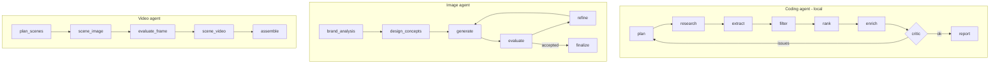

# Startup Scout

[](https://github.com/Sudarshan-veera/AI-coder-image_generator-video_maker-orchestrator/actions)

A system of **three independent agents**. Each agent is an *orchestrator of independent tasks*
built on one small shared engine (`common/orchestrator.py`).

| Agent | Purpose | Model | Where it runs |
|---|---|---|---|
| Coding agent (`harness/`, OpenCode agent `scout`) | Top 10 best-performing startups for any category | Qwen3.5 9B via Ollama (open source) | **Local only, no cloud LLM** |
| Image agent (`image_agent/`) | Team logo | Local: Ollama LLM + SDXL-Turbo + CLIP | Local (GPU) |
| Video agent (`video_agent/`) | Video explaining the agents and their orchestration | Local: SDXL-Turbo art, espeak-ng voice, ffmpeg | Local (GPU) |



Details: [docs/AGENTS.md](docs/AGENTS.md), [docs/ARCHITECTURE.md](docs/ARCHITECTURE.md), [docs/TESTING.md](docs/TESTING.md), [MODELS.md](MODELS.md).

## Quick start (WSL Ubuntu 24.04)
```bash
curl -fsSL https://ollama.com/install.sh | sh
ollama pull qwen3.5:9b
ollama create agent-coder -f Modelfile
python3 -m venv .venv && source .venv/bin/activate
pip install -r requirements.txt
export AGENT_MODEL=agent-coder
make startups CATEGORY="FinTech"
```

## Use each agent
```bash
make startups CATEGORY="HealthTech"      # coding agent (script)
opencode                                  # coding agent (chat): pick `scout`, type a category
export TEAM_NAME="Your Team"
make logo                                 # image agent  -> outputs/team_logo.png
make video                                # video agent  -> outputs/how_it_works.mp4
```
Every agent writes a task trace (`outputs/trace.json`, `image_agent_trace.json`,
`video_agent_trace.json`) with task status, retries and timings.

## Results

Required deliverables (run 1): [team logo](runs/run1_first_pipeline/team_logo.png),
[agent workflow video](runs/run1_first_pipeline/how_it_works.mp4),
[Top 10 FinTech startups](runs/run1_first_pipeline/fintech_top10.md).
All five runs, in order, are in [runs/](runs/README.md).

## Test and verify
```bash
make test      # offline unit tests, all external calls mocked
make verify    # checks the real outputs of the three agents
```

## Repository layout


## Configuration
| Variable | Default | Meaning |
|---|---|---|
| AGENT_MODEL | agent-coder | Ollama model for the coding agent |
| AGENT_CTX | 16384 | context window used by the harness |
| MAX_ROUNDS | 3 | research rounds before the critic gives up |
| TEAM_NAME | Startup Scout | text in the logo |
| LOCAL_IMAGE_MODEL / LOCAL_VIDEO_MODEL / TTS_VOICE | stabilityai/sdxl-turbo / Lightricks/LTX-Video / en-us | local image, video and voice models |

## Limitations
- Figures come from web snippets read by a 9B local model and may be wrong; every row lists sources.
- DuckDuckGo search can be rate limited.
- Image and video generation need a CUDA GPU (SDXL-Turbo; LTX-Video motion is optional and slower).
- No cloud LLM is used by the coding agent (enforced by `tests/test_local_only.py`).

## Team
- Sudarshan-veera ([GitHub](https://github.com/Sudarshan-veera))
- NAME 2 (GitHub: handle)
- NAME 3 (GitHub: handle)

## License
MIT
