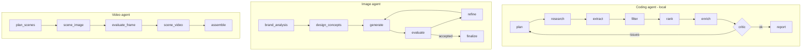

# Startup Scout

[](https://github.com/Sudarshan-veera/startup-scout/actions)

A system of **three independent agents**. Each agent is an *orchestrator of independent tasks*
built on one small shared engine (`common/orchestrator.py`).

| Agent | Purpose | Model | Where it runs |
|---|---|---|---|
| Coding agent (`harness/`, OpenCode agent `scout`) | Top 10 best-performing startups for any category | Qwen3.5 9B via Ollama (open source) | **Local only, no cloud LLM** |
| Image agent (`image_agent/`) | Team logo | Gemini text + image models (API) | API |
| Video agent (`video_agent/`) | Video explaining the agents and their orchestration | Gemini + Veo (API), ffmpeg | API |



Details: [docs/AGENTS.md](docs/AGENTS.md), [docs/ARCHITECTURE.md](docs/ARCHITECTURE.md), [docs/TESTING.md](docs/TESTING.md), [MODELS.md](MODELS.md).

## Quick start (WSL Ubuntu 24.04)
```bash
curl -fsSL https://ollama.com/install.sh | sh
ollama pull qwen3.5:9b
ollama create agent-coder -f Modelfile
python3 -m venv .venv && source .venv/bin/activate
pip install -r requirements.txt
export AGENT_MODEL=agent-coder
make startups CATEGORY="FinTech"
```

## Use each agent
```bash
make startups CATEGORY="HealthTech"      # coding agent (script)
opencode                                  # coding agent (chat): pick `scout`, type a category
export GEMINI_API_KEY=...  TEAM_NAME="Your Team"
make logo                                 # image agent  -> outputs/team_logo.png
make video                                # video agent  -> outputs/how_it_works.mp4
```
Every agent writes a task trace (`outputs/trace.json`, `image_agent_trace.json`,
`video_agent_trace.json`) with task status, retries and timings.

## Test and verify
```bash
make test      # offline unit tests, all external calls mocked
make verify    # checks the real outputs of the three agents
```

## Repository layout


## Configuration
| Variable | Default | Meaning |
|---|---|---|
| AGENT_MODEL | agent-coder | Ollama model for the coding agent |
| AGENT_CTX | 16384 | context window used by the harness |
| MAX_ROUNDS | 3 | research rounds before the critic gives up |
| GEMINI_API_KEY | none | image/video agents only |
| TEAM_NAME | Startup Scout | text in the logo |
| TEXT_MODEL / IMAGE_MODEL / VIDEO_MODEL | gemini-2.5-flash / gemini-2.5-flash-image / veo-3.0-fast-generate-001 | model names |

## Limitations
- Figures come from web snippets read by a 9B local model and may be wrong; every row lists sources.
- DuckDuckGo search can be rate limited.
- Veo needs a billing-enabled key; the video agent has a `--slideshow` fallback.
- No cloud LLM is used by the coding agent (enforced by `tests/test_local_only.py`).

## Team
- Sudarshan-veera ([GitHub](https://github.com/Sudarshan-veera))
- Add the other two team members here

## License
MIT
